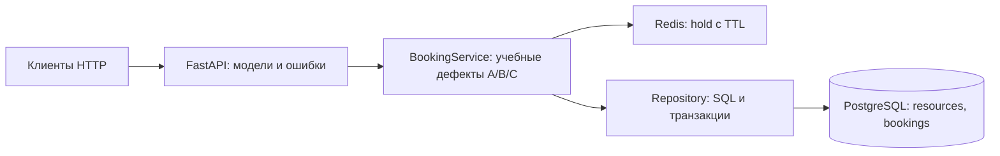

# Архитектура

main.py собирает приложение, задаёт HTTP-маршруты, обработчики ошибок и lifespan. На старте применяются схема и новые миграции; затем проверяется Redis. Синхронные маршруты FastAPI выполняются в пуле потоков, поэтому параллельные запросы действительно пересекаются. Одно PostgreSQL-соединение на операцию упрощает владение транзакцией. Разделяемый клиент Redis использует свой пул соединений.

service.py содержит логику удержаний и подтверждений. repository.py выполняет параметризованный SQL; контекст with connection фиксирует запись при успехе и откатывает её при исключении. Предварительный запрос наличия брони нужен для понятного раннего ответа, но сам по себе не защищает инвариант.

В resources находятся id и name; три записи создаются повторяемым seed. В bookings хранятся UUID брони, ссылка на ресурс, клиент, UUID удержания, статус CONFIRMED и серверное время записи. Отмены броней нет. Поэтому защита «одна строка на resource_id» подходит предметной модели. При появлении отмен понадобилось бы пересмотреть область ограничения.

Redis хранит строку JSON {"clientId":"alice","holdId":"..."} в ключе booking-lab:hold:1. TTL задаёт Redis, время из тела запроса клиента не используется как доказательство действительности. После подтверждения ключ доживает TTL; отсутствие раннего удаления не мешает SQL запрещать повторную бронь.

## Места изменений

- A: окно между чтением ключа и записью удержания.
- B: отсутствие окончательной уникальности и обработки её нарушения.
- C: неполная авторизация подтверждения.
- Дополнение A: заготовка release и маршрут DELETE /holds.

Для SQL-защиты создайте db/migrations/001_booking_resource_unique.sql. Готовый механизм применяет файлы по имени и записывает их в schema_migrations. После применения файл не редактируют, для следующего изменения добавляют новый. Пересборка docker compose up --build -d переносит файл в образ и запускает миграции при старте. Команда docker compose exec app python -m scripts.migrate повторно вызывает механизм в уже собранном образе. [Отдельная инструкция](MIGRATIONS.md) описывает содержание файла, сохранность записей, дубликаты и проверку реестра.

Hooks содержит четыре контрольные точки, которые в обычном приложении ничего не делают. Через HTTP задать callback или задержку нельзя. Тест передаёт callbacks прямо в фабрику приложения. Сохраните after_hold_read перед попыткой записи удержания, after_authorization сразу после успешной проверки токена, before_booking_insert после предварительных проверок перед SQL-записью. Для освобождения вызовите before_release_delete перед атомарной проверкой и удалением; если делаете предварительный GET, точка должна быть после него. Эти точки задают порядок операций и не подменяют ответы хранилищ. Не держите блокировку Python или SQL до барьера, на котором ждёт второй участник.

Тесты создают схему lab_test_&lt;uuid&gt; по неизменяемому снимку tests/fixtures/starter_schema.sql, добавляют контрольную бронь и применяют миграции приложения. Контрольная запись должна сохраниться: пересоздание таблицы с потерей данных не подходит. Это проверяет обновление существующей БД; одной правки db/init.sql для прохождения B07 недостаточно. После запуска удаляется только тестовая схема. Между сценариями очищается только её таблица bookings. Для Redis используется DB 15 и уникальный префикс каждого сценария. Основное приложение работает в public и DB 0. Параллельный запуск разных раннеров безопасен за счёт отдельных схем; pytest-xdist внутри одного запуска здесь не предусмотрен.
