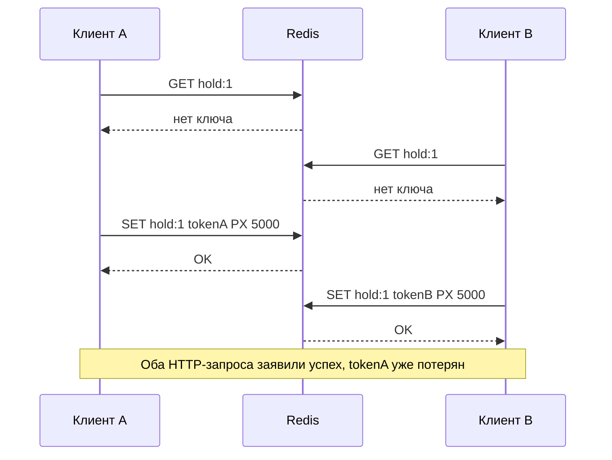
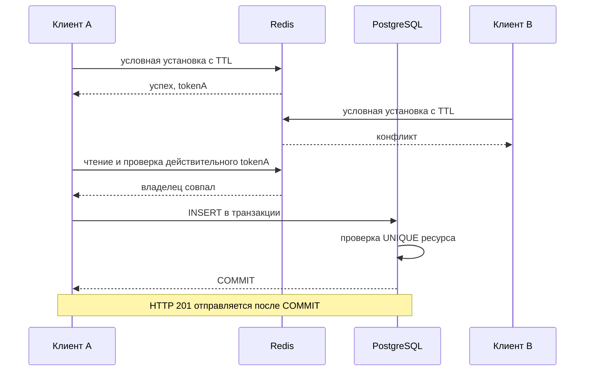
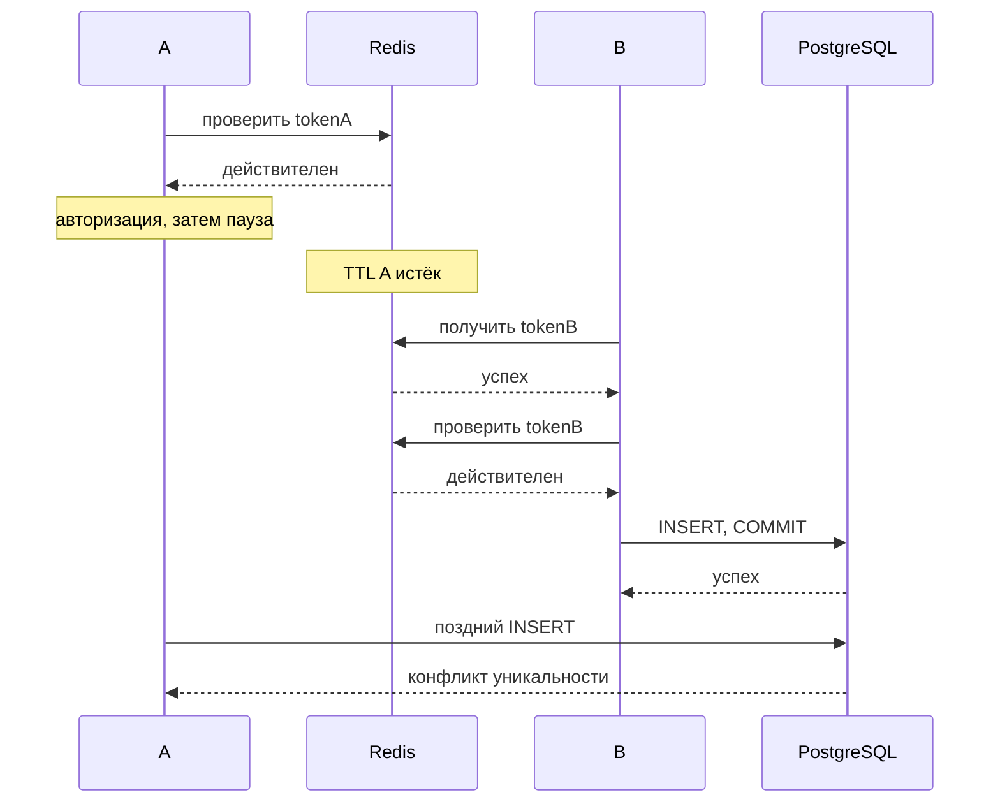

# Теория для практической работы

## Конкурентный доступ

Конкурентные операции могут пересекаться по времени. Даже на одном CPU поток A способен приостановиться после чтения, пока B уже меняет значение. Сетевые обращения расширяют это окно. GIL Python не превращает несколько обращений к PostgreSQL и Redis в неделимую операцию.

Check-then-act: «проверить, что места нет в бронированиях; добавить бронь». Если другая операция вклинится между этими шагами, проверка устареет.



Проверка гонки должна проверять утверждение о состоянии. Два HTTP 201 уже нарушают контракт захвата, даже если в Redis физически остался только один ключ.

## Первые команды Redis

Redis хранит ключи и значения в памяти. В этой работе достаточно строк; JSON сериализует пару клиент/токен. В docker compose exec redis redis-cli попробуйте ключ с отдельным учебным префиксом:

```text
SET tutorial:lease demo NX PX 5000
GET tutorial:lease
PTTL tutorial:lease
DEL tutorial:lease
```

NX разрешает установить только отсутствующий ключ. PX задаёт миллисекунды до истечения. Условие установки и TTL выполняются одной командой: нет окна между проверкой и записью. Успех возвращает OK, невыполненное условие возвращает nil; redis-py представляет его как None. Полагайтесь на результат команды, а не на отдельный GET до неё. [Официальное описание SET](https://redis.io/docs/latest/commands/set/).

PTTL возвращает остаток в миллисекундах, -2 при отсутствии ключа, -1 у ключа без срока. Не используйте PTTL как самостоятельное доказательство владения: срок не говорит, кому принадлежит значение. Истёкший ключ при обращении больше не даёт действительного удержания. Учебный тест сокращает TTL через PEXPIRE и ждёт реального исчезновения ключа с ограничением времени. [PTTL](https://redis.io/docs/latest/commands/pttl/), [EXPIRE](https://redis.io/docs/latest/commands/expire/).

Токен должен отличаться у каждого захвата, в том числе у одного клиента после повторного получения ресурса. UUIDv4 здесь подходит как непредсказуемый идентификатор. Имя клиента легко повторить, поэтому одного clientId недостаточно. В реальном публичном сервисе потребовались бы TLS и пользовательская аутентификация.

## Транзакция и уникальность PostgreSQL

Транзакция объединяет SQL-изменения: COMMIT делает их видимыми другим транзакциям, ROLLBACK отменяет. В psycopg контекст соединения управляет завершением транзакции. После SQL-ошибки нельзя продолжать выполнять команды до отката этой транзакции. [Транзакции PostgreSQL](https://www.postgresql.org/docs/16/tutorial-transactions.html), [контексты psycopg](https://www.psycopg.org/psycopg3/docs/basic/transactions.html).

Обычный READ COMMITTED даёт каждому SELECT снимок зафиксированных данных на начало команды. Два SELECT могут одновременно увидеть свободный ресурс. Само наличие BEGIN/COMMIT вокруг SELECT и INSERT не запрещает дубликат. [Изоляция](https://www.postgresql.org/docs/16/transaction-iso.html).

Ограничение UNIQUE описывает допустимое состояние таблицы и действует для всех клиентов БД. Конкурирующий INSERT может ждать исхода другой транзакции, затем завершиться нарушением уникальности. Это ожидаемый бизнес-конфликт, который API должен перевести в 409. Не перехватывайте все ошибки БД как конфликт: недоступность хранилища и ошибка SQL требуют другой диагностики. [Ограничения](https://www.postgresql.org/docs/16/ddl-constraints.html), [проверка уникальности индексом](https://www.postgresql.org/docs/16/index-unique-checks.html).



## Три момента времени

Проверка срока: Redis определяет, существует ли ещё ключ при чтении. Авторизация: сервис получает действительное значение и проверяет клиента, ресурс и UUID удержания. Commit: PostgreSQL фиксирует строку. Между ними проходят сетевые вызовы и выполнение Python.

В этом задании логическая точка авторизации находится в момент чтения ключа Redis, если прочитанное значение совпало с предъявленными данными. Сравнение в Python подтверждает авторизацию на момент этого чтения. Если ключ уже истёк при чтении, подтверждение запрещено. Если TTL истёк после чтения совпавшего значения, SQL-операция может завершиться. Этот контракт не обещает владение Redis до момента commit.



Если первым вставит A, он может победить, хотя B уже держит новый ключ Redis. Оба порядка допустимы в заданной семантике, две SQL-брони недопустимы. Тест E02 управляет порядком так, чтобы первым фиксировался B.

## Граница двух хранилищ

Транзакция PostgreSQL не охватывает Redis, а Lua Redis не управляет commit PostgreSQL. Повторный GET перед записью сужает окно, но не устраняет его. Возможен также захват Redis после устаревшей SQL-проверки, когда другой клиент уже зафиксировал бронь. Поэтому Redis ограничивает временное соперничество, а PostgreSQL хранит окончательное решение.

Сбой процесса после SQL commit и до HTTP-ответа оставляет бронь без известного клиенту результата. Повтор вернёт конфликт; идемпотентный ключ запроса мог бы улучшить контракт, но не входит в обязательную часть. Потеря Redis после перезапуска освобождает удержания, однако не должна разрушать SQL-инвариант.

Усиление, пригодное для обсуждения: хранить аренду и бронь в одной SQL-БД, проверять актуальную аренду под блокировкой строки и фиксировать результат одной транзакцией. Так меняются нагрузка и стоимость продления. Fencing token помогает только если защищаемое хранилище само отклоняет устаревший номер; выдача номера в Redis сама по себе этого не делает.

Для освобождения сравните и удалите ключ атомарно. Иначе старый клиент способен удалить новое удержание после истечения собственного TTL. Lua-скрипт Redis выполняется атомарно относительно других команд; делайте его коротким. [Сценарии Redis](https://redis.io/docs/latest/develop/programmability/eval-intro/). Не требуется писать собственный распределённый lock-сервис.
